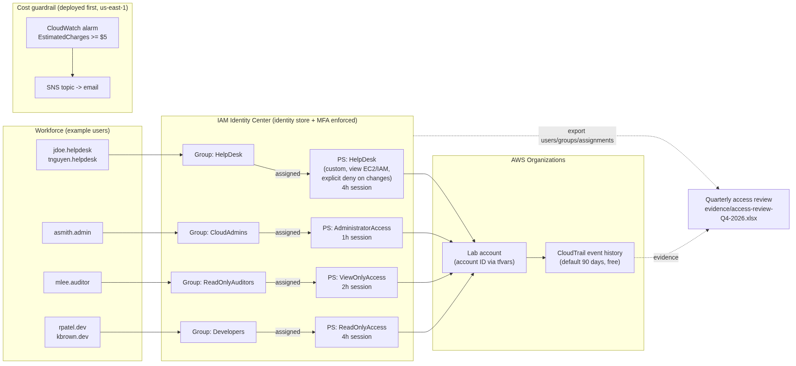

# OptiPrim3 AWS Identity Lab: Identity Center, Least Privilege, MFA, and Access Reviews

**Scenario.** OptiPrim3 is a fictional logistics company. Its load-documentation app (bills of lading,
load photos, delivery receipts) runs in one AWS account. This lab secures workforce access to that
account the way a small IT team would: one sign-in per person through **AWS IAM Identity Center**,
role-based **permission sets**, **MFA on every sign-in**, a **joiner/mover/leaver (JML) runbook**, and a
**quarterly access review** with findings and remediation tracking. All users are fictional, at example.com.

Built by Lamont as a portfolio project. Background: about 2 years in IT support, CompTIA Security+,
AWS Certified Cloud Practitioner. The lab is aimed at Service Desk / IT Support Tier 2 and IAM
Analyst work: provisioning, deprovisioning, MFA problems, "why can't I access X", and audit evidence.

> **Status (2026-10-18):** Deployed to AWS. Billing alarm, SNS topic, and $5 Budget are applied, plus all 35 Identity Center
> resources, with every permission set provisioned. CLI proof is in [evidence/cli/](evidence/cli/) (account ID and email redacted).
> Still to do, all in the console: MFA settings, user password setup, persona sign-in tests, screenshots. See [docs/build-checklist.md](docs/build-checklist.md).

---

## Deliverables

| Deliverable | Where |
|---|---|
| Architecture diagram | [diagrams/architecture.png](diagrams/architecture.png) (source: [architecture.mmd](diagrams/architecture.mmd)) |
| Permission-set matrix | [docs/permission-set-matrix.md](docs/permission-set-matrix.md) |
| Access-review report | [evidence/access-review-Q4-2026.xlsx](evidence/access-review-Q4-2026.xlsx) (example data) |
| JML runbook | [docs/jml-runbook.md](docs/jml-runbook.md) |
| MFA and least-privilege evidence | Screenshots 07, 15, 16, 17, 18, 18b (see [Screenshots](#screenshots)); policy tests in `terraform/02-identity-center/tests/`; IAM policy simulator results in [evidence/cli/11-policy-simulator.txt](evidence/cli/11-policy-simulator.txt) |
| Deployment proof (CLI) | [evidence/cli/](evidence/cli/), regenerate with `scripts/verify_identity_center.sh <account-id>` |
| Findings and remediation | [docs/findings-and-remediation.md](docs/findings-and-remediation.md) (sample until real evidence exists) |

## Goal

1. Replace per-user IAM accounts and long-lived access keys with one identity per person, signing in through Identity Center with MFA.
2. Grant access only through **groups mapped to permission sets**, so that onboarding, role changes, and offboarding are group membership changes.
3. Give each support role a **custom least-privilege** permission set: the service desk can troubleshoot but not change anything, and security analysts can read logs and findings but can't turn them off.
4. Run and document a **quarterly access review** that finds real problems (a stale account, an over-privileged user) and tracks them to closure.

## Architecture



| Group | Example users | Permission set | Session | What it allows |
|---|---|---|---|---|
| HelpDesk | jdoe.helpdesk, tnguyen.helpdesk | **HelpDesk** (custom) | 4h | View EC2, ELB, Auto Scaling, CloudWatch, IAM. Explicit deny on terminate/stop/delete, IAM writes, SSO/Identity Store writes, Organizations. |
| CloudAdmins | asmith.admin | AdministratorAccess | **1h** | Full admin. Limited to `max_admins` (default 2) users, security-key MFA. |
| SecurityAnalysts | jgarcia.secanalyst | **SecurityAnalyst** (custom) | 4h | Read CloudTrail, CloudWatch Logs, GuardDuty, Security Hub, Config, IAM Access Analyzer. Explicit deny on stopping, deleting, or editing any of them. |
| ReadOnlyAuditors | mlee.auditor | ViewOnlyAccess + optional evidence policy | 2h | Resource metadata, plus read on `s3://<evidence bucket>/approved-evidence/*` when `evidence_bucket_name` is set. |
| Developers | rpatel.dev, kbrown.dev | ReadOnlyAccess | 4h | Read-only access to the app account. |

Full detail (allows, denies, approver, justification): [docs/permission-set-matrix.md](docs/permission-set-matrix.md).
Account IDs come from `terraform.tfvars`, which is git-ignored.

## Controls demonstrated

| Control | How it shows up in this lab |
|---|---|
| **Least privilege** | Custom HelpDesk and SecurityAnalyst permission sets: an allow-list of read actions plus explicit `Deny` statements. Auditors get ViewOnly plus a single approved evidence prefix. Tests check that SecurityAnalyst allows only read verbs. |
| **MFA** | Identity Center prompts for MFA on every sign-in and requires device registration at first sign-in. Admins use a security key (phishing-resistant). |
| **Separation of duties** | Terraform validation fails the plan if any CloudAdmins member is also in ReadOnlyAuditors or SecurityAnalysts. Reviewers don't review their own access. |
| **Small privileged group** | A `terraform_data` precondition fails the plan if CloudAdmins exceeds `max_admins`. |
| **Periodic access review** | Workbook with inventory, Keep/Modify/Revoke decisions, findings, remediation, and sign-off. |
| **No long-lived credentials** | Users get temporary credentials from the access portal or `aws sso login`. No IAM users or access keys for people. |
| **Group-based access** | Every account assignment targets a group, never an individual user (asserted in tests). |

## Mapping to NIST SP 800-53 Rev. 5

| Control | Title | Implementation in this lab | Evidence |
|---|---|---|---|
| **AC-2** | Account Management | Accounts created only through the JML runbook with a ticket and approval. Group-based provisioning in Terraform. Leavers disabled within 24h. Quarterly review. AC-2(3): accounts inactive 90+ days are disabled. AC-2(4): CloudTrail records identity changes. | `docs/jml-runbook.md`, review workbook, `docs/findings-and-remediation.md`, CloudTrail screenshot |
| **AC-6** | Least Privilege | Custom HelpDesk and SecurityAnalyst sets with explicit denies. ViewOnly plus evidence prefix for auditors. AC-6(5): admin limited to a small group with 1h sessions. AC-6(7): privileges reviewed quarterly. AC-6(9): privileged actions logged in CloudTrail. | `docs/permission-set-matrix.md`, `permission_sets.tf`, tests, denied-action screenshots |
| **IA-2** | Identification and Authentication (Organizational Users) | One unique user per person, no shared accounts. IA-2(1)/(2): MFA for privileged and non-privileged users. IA-2(8): security keys for admins. | MFA settings and MFA prompt screenshots |
| **IA-5** | Authenticator Management | Users set their own initial password through a one-time emailed link (the service desk never sends passwords). AWS-enforced password complexity. MFA device registration and reset follow the runbook with identity verification. Temporary credentials instead of access keys. | `docs/jml-runbook.md` (sections 5 and 8), Users sheet MFA column |

Related: AC-5 (Separation of Duties) through the SoD validation rule.

## Repository layout

```
.
├── README.md
├── diagrams/            architecture.mmd, architecture.png
├── docs/
│   ├── build-checklist.md            exact console/CLI steps + screenshots to capture
│   ├── findings-and-remediation.md   sample Q4 findings and recommendations
│   ├── jml-runbook.md                joiner/mover/leaver service desk SOP
│   └── permission-set-matrix.md      persona/group/permission set matrix
├── evidence/
│   ├── cli/                          redacted CLI proof of the live deployment
│   ├── access-review-Q4-2026.xlsx    EXAMPLE DATA quarterly access review
│   └── build_access_review.py        regenerates the workbook (openpyxl)
├── screenshots/         filled in after the AWS build
├── scripts/
│   ├── check_membership_drift.py     flags console-added group memberships
│   └── verify_identity_center.sh     collects redacted CLI evidence into evidence/cli/
└── terraform/
    ├── 01-billing-alarm/       deploy FIRST: CloudWatch billing alarm + SNS email (us-east-1)
    └── 02-identity-center/     groups, users, permission sets, account assignments
        └── tests/offline.tftest.hcl
```

## Build summary

Full steps are in [docs/build-checklist.md](docs/build-checklist.md). In short:

1. **Secure the account and set the cost guardrail first.** MFA on the root user, and enable "Receive CloudWatch billing alerts". The $5 AWS Budget is created by `01-billing-alarm`.
2. **Enable IAM Identity Center** (organization instance; this also enables AWS Organizations). Terraform ran with a dedicated temporary IAM user whose key lived only in environment variables. That user is deleted at teardown.
3. **Configure MFA**: prompt on every sign-in, require registration at first sign-in.
4. **Deploy `terraform/01-billing-alarm`**: a CloudWatch `EstimatedCharges >= $5` alarm that emails through SNS, plus a $5 monthly AWS Budget (email at 80% actual and 100% forecast). Confirm the subscription email.
5. **Deploy `terraform/02-identity-center`**: 5 groups, 7 example users, 5 permission sets, group-to-account assignments.
6. **Test as each persona.** The HelpDesk user can view EC2/IAM, but terminate and IAM create are denied. The SecurityAnalyst can run CloudTrail lookups but is denied `StopLogging`.
7. **Simulate the review findings.** Add `kbrown.dev` to CloudAdmins in the console (drift) and catch it with `scripts/check_membership_drift.py` (Terraform's plan won't see it), then remediate. Disable the stale `tnguyen.helpdesk` account.
8. **Complete the access review** and capture screenshots.
9. **Tear down** (below).

```bash
cd terraform/01-billing-alarm
cp terraform.tfvars.example terraform.tfvars   # set alert_email; file is git-ignored
terraform init && terraform plan && terraform apply

cd ../02-identity-center
cp terraform.tfvars.example terraform.tfvars   # set target_account_id
terraform init && terraform test               # offline tests, no AWS calls
terraform plan && terraform apply
```

## Cost

**Expected cost: $0.**

- IAM Identity Center and AWS Organizations have no charge.
- CloudWatch: the first 10 alarms are in the free tier. SNS email: the first 1,000 notifications per month are free.
- CloudTrail event history (90 days of management events) is free. No paid trail is created.
- GuardDuty, Security Hub, and Config are **not enabled** by this lab. The SecurityAnalyst permissions work whether or not those services are on. If you turn them on to test, use the 30-day free trials and disable them at teardown.
- The optional evidence bucket costs essentially nothing for a few small files (S3 free tier covers 5 GB).
- The billing alarm and a $5 Budget are set **before** anything else is built.

## Teardown

1. `cd terraform/02-identity-center && terraform destroy` removes assignments, permission sets, users, and groups.
2. Terminate any test EC2 instance. Disable GuardDuty, Security Hub, and Config if you enabled them. Empty and delete the evidence bucket if you created one.
3. Delete the `tech-operator-lab` IAM user and its access key last (the only long-lived credential used).
4. Optional: Identity Center > Settings > Delete IAM Identity Center configuration.
5. Keep `01-billing-alarm` (alarm, SNS, and Budget are free), or remove it with `terraform destroy` in that folder.
6. Check Billing > Bills: expected $0.00.

## Screenshots

> **Placeholders.** These files don't exist yet. Capture them during the build (see the checklist), save them in `screenshots/` with these exact names, and redact the account ID, email addresses, and access portal URL before committing.

| # | File | Shows |
|---|---|---|
| 01 | `screenshots/01-root-mfa-enabled.png` | Root user has MFA |
| 02 | `screenshots/02-billing-alerts-enabled.png` | Billing preferences: CloudWatch billing alerts on |
| 03 | `screenshots/03-budget-5usd.png` | $5 AWS Budget |
| 04 | `screenshots/04-billing-alarm.png` | CloudWatch alarm `EstimatedCharges >= 5` |
| 05 | `screenshots/05-sns-subscription-confirmed.png` | SNS email subscription Confirmed |
| 06 | `screenshots/06-identity-center-enabled.png` | Identity Center settings: organization instance, region |
| 07 | `screenshots/07-mfa-settings.png` | MFA: every sign-in, require registration |
| 08 | `screenshots/08-terraform-plan.png` | `terraform plan` for 02-identity-center |
| 09 | `screenshots/09-groups.png` | Groups list with member counts |
| 10 | `screenshots/10-permission-sets.png` | Permission sets with session durations |
| 11 | `screenshots/11-account-assignments.png` | Account assignments: groups to permission sets |
| 12 | `screenshots/12-tnguyen-disabled.png` | Stale user disabled (F-Q4-02) |
| 13 | `screenshots/13-kbrown-groups-after.png` | Over-privileged membership removed (F-Q4-01) |
| 14 | `screenshots/14-drift-detected.png` | Drift script flagging the console-added admin membership |
| 15 | `screenshots/15-mfa-registration-prompt.png` | First sign-in MFA registration as `jdoe.helpdesk` |
| 16 | `screenshots/16-access-portal-helpdesk.png` | Access portal showing only the HelpDesk role |
| 17 | `screenshots/17-helpdesk-ec2-view.png` | HelpDesk user can view EC2 instances |
| 18 | `screenshots/18-helpdesk-denied.png` | HelpDesk denied on terminate / create IAM user |
| 18b | `screenshots/18b-secanalyst-lookup-and-denied.png` | SecurityAnalyst: CloudTrail lookup works, `StopLogging` denied |
| 19 | `screenshots/19-cloudtrail-identity-events.png` | CloudTrail event history: sign-in and Identity Store events |
| 20 | `screenshots/20-teardown-bill-zero.png` | `terraform destroy` output and $0.00 bill |

## Future extension: OptiPrim3 Compliance Intelligence Assistant

The documents in this repo (permission-set matrix, JML runbook, access-review report, findings) are
written to feed a later, separate project: a retrieval-augmented (RAG) assistant that answers questions
such as "who approves admin access?" or "what is the leaver SLA?" from OptiPrim3 policy. That
assistant would only **retrieve and cite policy**. It would never grant, change, or approve access;
those actions stay with the JML process and Identity Center. There is no RAG code in this repo.

## Talking points

Fill in after the build. Prompts: why group-based access makes offboarding faster; why the custom
sets use explicit denies; why security analysts must not be able to stop logging; how the review
caught console drift that Terraform's plan missed; what changes at 500 people (SCIM from Entra ID
or Okta, automated reviews).

## Security notes

- No secrets, account IDs, state files, or real `*.tfvars` are committed (see `.gitignore`).
- `.terraform.lock.hcl` is committed on purpose to pin provider versions.
- All data in `evidence/` and `docs/findings-and-remediation.md` is fictional sample data and is labeled that way.
